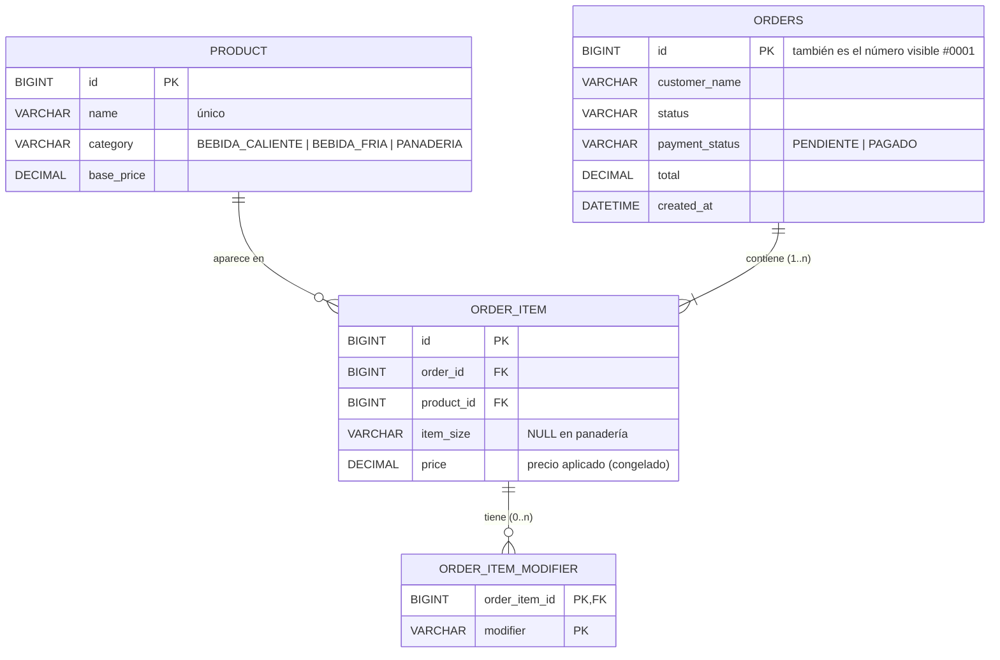
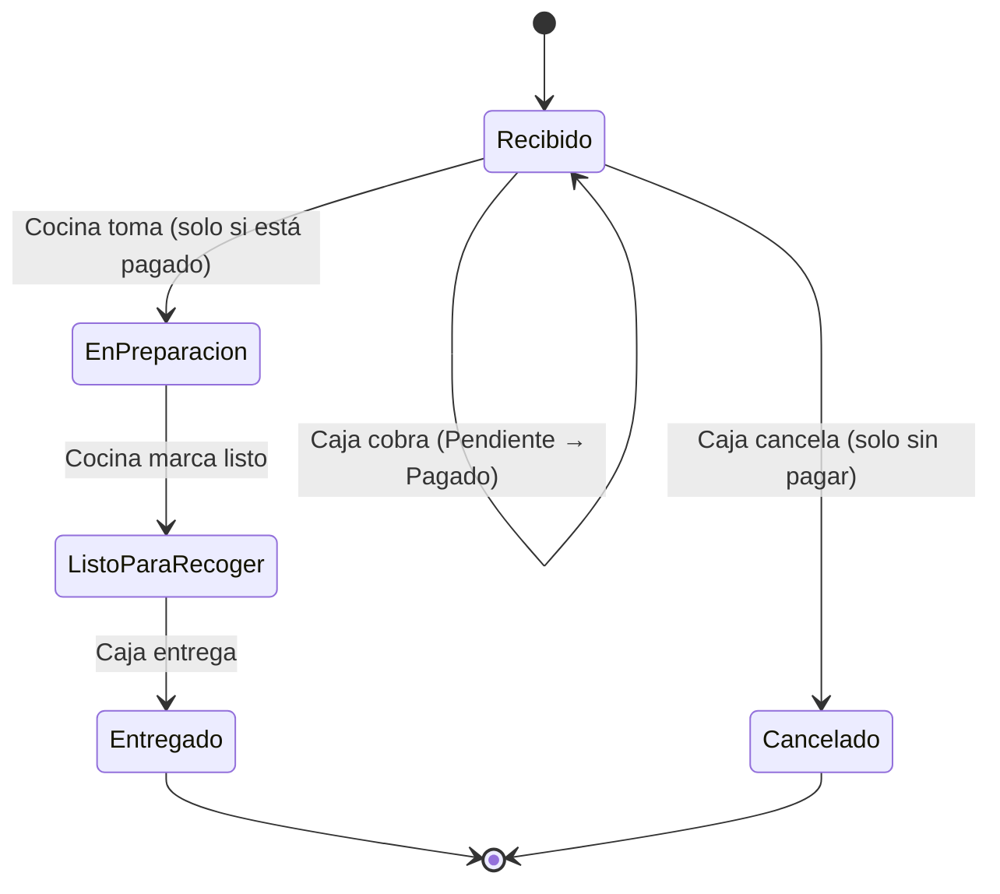

# design.md — Módulo de Pedidos · Café Aroma

## Arquitectura
Una sola aplicación Spring Boot organizada por capas. La pantalla y la API usan **el mismo servicio**, así las reglas no se duplican.

```
Navegador (Thymeleaf + JS)        Cliente REST (PowerShell / Postman)
        │                                    │
 CounterController (/)            OrderApiController / ProductApiController (/api)
        └───────────────┬────────────────────┘
               OrderService · CatalogService   ← reglas de negocio
                        │
        CustomerOrderRepository · ProductRepository (Spring Data JPA)
                        │
                      MySQL
```

## Modelo de datos



**Precio histórico:** `order_item.price` guarda el precio cobrado en ese momento y `orders.total` la suma. Si mañana cambia `product.base_price`, los pedidos anteriores no cambian.

**Restricciones:** claves foráneas, `CHECK` sobre los valores permitidos de estado, pago, tamaño y modificador, y precios ≥ 0. La regla "1 o más ítems" la valida el servicio (SQL no la puede expresar con un `CHECK`).

## Flujo de estados


Las transiciones por estado están en `OrderStatus.canTransitionTo`. Las condiciones que dependen del pago están en `CustomerOrder` (`canBePaid`, `canBeCancelled`, `canBeTaken`, `canBeMarkedReady`, `canBeDelivered`). `OrderService` tiene un método por acción (`registerPayment`, `cancel`, `take`, `markReady`, `deliver`) que valida la regla y responde 409 si el estado no permite el paso, o 400 si falta o sobra el pago. El pago nunca vuelve a Pendiente.

| Acción | Quién | Estado | Pago |
|---|---|---|---|
| Crear | Caja | → Recibido | Pendiente |
| Cobrar | Caja | Cualquiera menos Cancelado o Entregado | Pendiente → Pagado |
| Cancelar | Caja | Recibido → Cancelado | Debe estar Pendiente |
| Tomar | Cocina | Recibido → En preparación | Debe estar Pagado |
| Listo | Cocina | En preparación → Listo para recoger | — |
| Entregar | Caja | Listo para recoger → Entregado | Debe estar Pagado |

## Endpoints

| Método | Ruta | Propósito | Respuestas |
|---|---|---|---|
| GET | `/api/products` | Menú con opciones válidas y recargos | 200 |
| POST | `/api/orders` | Crear pedido `{customerName, items:[{productId, size, modifiers}]}` | 201 · 400 |
| GET | `/api/orders?status=X` | Listar (filtro opcional por estado) | 200 · 400 (estado inválido) |
| GET | `/api/orders/{id}` | Detalle | 200 · 404 |
| GET | `/api/orders/kitchen` | Pedidos de cocina: Recibidos pagados y En preparación | 200 |
| PATCH | `/api/orders/{id}/payment` | Caja cobra `{"paymentStatus":"PAGADO"}` | 200 · 400 · 404 |
| PATCH | `/api/orders/{id}/cancel` | Caja cancela | 200 · 400 · 404 · 409 |
| PATCH | `/api/orders/{id}/take` | Cocina toma (→ En preparación) | 200 · 400 · 404 · 409 |
| PATCH | `/api/orders/{id}/ready` | Cocina marca listo (→ Listo para recoger) | 200 · 404 · 409 |
| PATCH | `/api/orders/{id}/deliver` | Caja entrega (→ Entregado) | 200 · 400 · 404 · 409 |

Hay un endpoint por acción (en vez de un `PATCH /status` genérico) para que cada regla y, más adelante, cada rol, quede en una ruta clara.

Errores: `{"status": 409, "message": "No se puede pasar un pedido de «En preparación» a «Cancelado». ..."}`

## Decisiones técnicas
| Decisión | Motivo |
|---|---|
| Tamaños, modificadores y estados como `enum` en Java (no tablas) | Son listas fijas del reto; no hay pantalla para administrarlas. Menos tablas, menos código. |
| Reglas del menú en `Category` | Un solo lugar define qué tamaños y modificadores admite cada categoría. |
| Tablas creadas con `schema.sql`, no por Hibernate | El SQL queda visible y revisable (fundamento SQL del Bloque 1). |
| Entidad `CustomerOrder`, tabla `orders` | `ORDER` es palabra reservada en SQL y JPQL. |
| DTO (clases con getters) en la API | No se exponen las entidades; la respuesta incluye etiquetas y acciones permitidas. |
| Thymeleaf + un archivo JS pequeño | Thymeleaf pinta el menú y el tablero; el JS solo arma el carrito y llama a `POST /api/orders`. |
| H2 solo en pruebas | Las pruebas de integración corren sin MySQL instalado. |
| Spring Boot 2.7.18 + Java 8 | El reto pide Java 8, y 2.7.x es la última línea de Spring Boot compatible con Java 8 (Spring Boot 3 y 4 exigen Java 17+). |

## Paquetes
```
com.cafearoma.pedidos
├── model        enums (Category, Size, Modifier, OrderStatus, PaymentStatus) y entidades
├── repository   interfaces Spring Data JPA
├── service      OrderService, CatalogService y excepciones de negocio
├── dto          clases de entrada y salida (DTO)
└── web          controladores API, controlador Thymeleaf y manejador de errores
```
