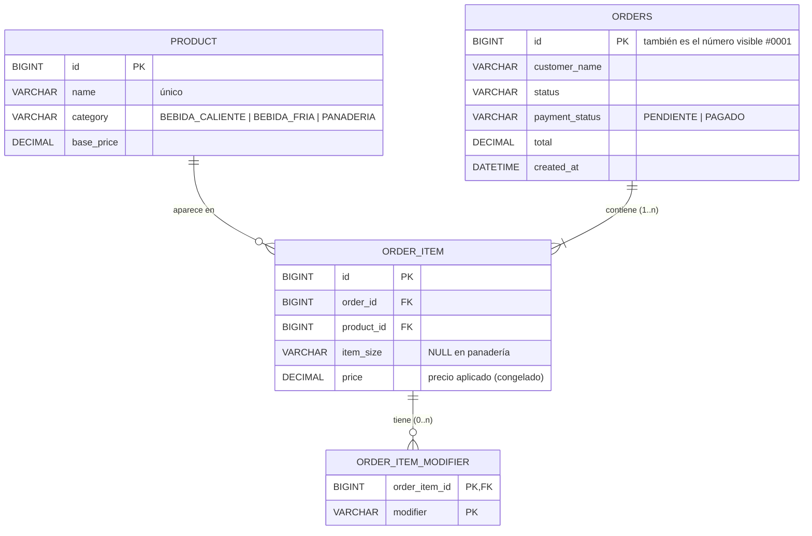
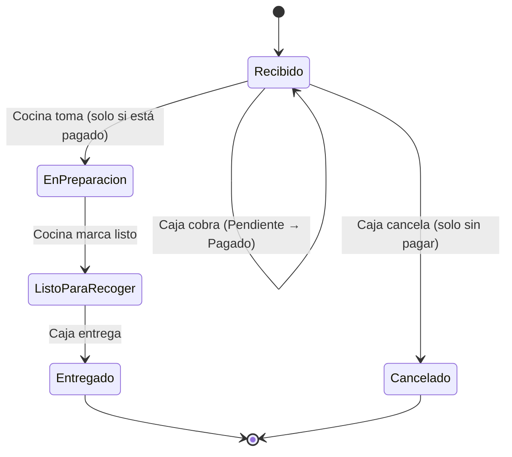

# design.md — Módulo de Pedidos · Café Aroma

## Arquitectura
Una sola aplicación Spring Boot organizada por capas. La pantalla y la API usan **el mismo servicio**, así las reglas no se duplican.

```
Navegador (Thymeleaf + JS)        Cliente REST (PowerShell / Postman)
        │                                    │
 PageController (/pedido, /caja,     OrderApiController / ProductApiController (/api)
   /cocina, /historial)
        └───────────────┬────────────────────┘
               OrderService · CatalogService   ← reglas de negocio
                        │
        CustomerOrderRepository · ProductRepository (Spring Data JPA)
                        │
                      MySQL
```

## Modelo de datos



**Precio histórico:** `order_item.price` guarda el precio cobrado en ese momento y `orders.total` la suma. Si mañana cambia `product.base_price`, los pedidos anteriores no cambian.

**Restricciones:** claves foráneas, `CHECK` sobre los valores permitidos de estado, pago, tamaño y modificador, y precios ≥ 0. La regla "1 o más ítems" la valida el servicio (SQL no la puede expresar con un `CHECK`).

## Flujo de estados


Las transiciones por estado están en `OrderStatus.canTransitionTo`. Las condiciones que dependen del pago están en `CustomerOrder` (`canBePaid`, `canBeCancelled`, `canBeTaken`, `canBeMarkedReady`, `canBeDelivered`). `OrderService` tiene un método por acción (`registerPayment`, `cancel`, `take`, `markReady`, `deliver`) que valida la regla y responde 409 si el estado no permite el paso, o 400 si falta o sobra el pago. El pago nunca vuelve a Pendiente.

| Acción | Quién | Estado | Pago |
|---|---|---|---|
| Crear | Caja | → Recibido | Pendiente |
| Cobrar | Caja | Cualquiera menos Cancelado o Entregado | Pendiente → Pagado |
| Cancelar | Caja | Recibido → Cancelado | Debe estar Pendiente |
| Tomar | Cocina | Recibido → En preparación | Debe estar Pagado |
| Listo | Cocina | En preparación → Listo para recoger | — |
| Entregar | Caja | Listo para recoger → Entregado | Debe estar Pagado |

## Páginas
| Ruta | Sección del menú ☰ | Rol | Qué hace |
|---|---|---|---|
| `/login` | — | Público | Inicio de sesión. `/` manda a la página del rol. |
| `/pedido` | Tomar pedido | CAJA | Menú y carrito; registra el pedido con el nombre del cliente. |
| `/caja` | Pedidos (caja) | CAJA | Pedidos activos por estado: cobrar, cancelar y entregar. Se actualiza sola. |
| `/cocina` | Cocina | COCINA | Por preparar (Recibidos y pagados) y En preparación: Tomar y Listo. Se actualiza sola. |
| `/historial` | Historial | CAJA, COCINA | Pedidos entregados y cancelados (solo lectura). |

## Seguridad (Spring Security 5.7)
- Configuración en `security/SecurityConfig`. Login con página propia (`/login`). Al entrar, caja cae en `/pedido` y cocina en `/cocina`. Cerrar sesión es `POST /logout`.
- **Usuarios:** `caja` (rol CAJA) y `cocina` (rol COCINA), en memoria. Las contraseñas llegan por `CAJA_PASSWORD` y `COCINA_PASSWORD` y se cifran con BCrypt al arrancar.
- **Permisos:** se validan por ruta en el servidor. El menú ☰ solo muestra las secciones del rol (`sec:authorize`), pero eso es comodidad y no reemplaza la validación.
- **Sin sesión:** las páginas mandan al login y la API responde **401** en JSON.
- **Sin permiso:** la API responde **403** en JSON y las páginas mandan a la página del rol.
- **CSRF:** activo para el navegador; los scripts envían el token que Thymeleaf pone en `<head>`. Las llamadas con usuario y contraseña (`curl.exe -u`) no lo necesitan.

## Endpoints

| Método | Ruta | Rol | Propósito | Respuestas |
|---|---|---|---|---|
| GET | `/api/products` | CAJA, COCINA | Menú con opciones válidas y recargos | 200 |
| POST | `/api/orders` | CAJA | Crear pedido `{customerName, items:[{productId, size, modifiers}]}` | 201 · 400 |
| GET | `/api/orders?status=X` | CAJA, COCINA | Listar (filtro opcional por estado) | 200 · 400 (estado inválido) |
| GET | `/api/orders/{id}` | CAJA, COCINA | Detalle | 200 · 404 |
| GET | `/api/orders/active` | CAJA | Pedidos activos (Recibido, En preparación, Listo para recoger) | 200 |
| GET | `/api/orders/kitchen` | COCINA | Recibidos pagados y En preparación | 200 |
| PATCH | `/api/orders/{id}/payment` | CAJA | Cobrar `{"paymentStatus":"PAGADO"}` | 200 · 400 · 404 |
| PATCH | `/api/orders/{id}/cancel` | CAJA | Cancelar | 200 · 400 · 404 · 409 |
| PATCH | `/api/orders/{id}/deliver` | CAJA | Entregar (→ Entregado) | 200 · 400 · 404 · 409 |
| PATCH | `/api/orders/{id}/take` | COCINA | Tomar (→ En preparación) | 200 · 400 · 404 · 409 |
| PATCH | `/api/orders/{id}/ready` | COCINA | Marcar listo (→ Listo para recoger) | 200 · 404 · 409 |

Todas responden además **401** sin sesión y **403** si el rol no tiene permiso.

Hay un endpoint por acción (en vez de un `PATCH /status` genérico) para que cada regla y cada rol queden en una ruta clara.

Errores: `{"status": 409, "message": "No se puede pasar un pedido de «En preparación» a «Cancelado». ..."}`

## Decisiones técnicas
| Decisión | Motivo |
|---|---|
| Tamaños, modificadores y estados como `enum` en Java (no tablas) | Son listas fijas del reto; no hay pantalla para administrarlas. Menos tablas, menos código. |
| Reglas del menú en `Category` | Un solo lugar define qué tamaños y modificadores admite cada categoría. |
| Tablas creadas con `schema.sql`, no por Hibernate | El SQL queda visible y revisable (fundamento SQL del Bloque 1). |
| Entidad `CustomerOrder`, tabla `orders` | `ORDER` es palabra reservada en SQL y JPQL. |
| DTO (clases con getters) en la API | No se exponen las entidades; la respuesta incluye etiquetas y acciones permitidas. |
| Thymeleaf + JS pequeño por página | Thymeleaf pinta el menú y el historial, y comparte encabezado y menú ☰ con un fragmento (`fragments/layout.html`). `order-form.js` arma el carrito y llama a `POST /api/orders`. |
| Caja y Cocina se actualizan con `fetch` cada 7 s | `live-board.js` consulta `/api/orders/active` o `/api/orders/kitchen` y repinta el tablero sin recargar. Los botones salen de las banderas del servidor y cada acción vuelve a pasar por las reglas del backend. |
| H2 solo en pruebas | Las pruebas de integración corren sin MySQL instalado. |
| Spring Boot 2.7.18 + Java 8 | El reto pide Java 8, y 2.7.x es la última línea de Spring Boot compatible con Java 8 (Spring Boot 3 y 4 exigen Java 17+). |

## Paquetes
```
com.cafearoma.pedidos
├── model        enums (Category, Size, Modifier, OrderStatus, PaymentStatus) y entidades
├── repository   interfaces Spring Data JPA
├── security     SecurityConfig (login, permisos por rol, usuarios) y Roles
├── service      OrderService, CatalogService y excepciones de negocio
├── dto          clases de entrada y salida (DTO)
└── web          controladores API, controlador Thymeleaf y manejador de errores
```
